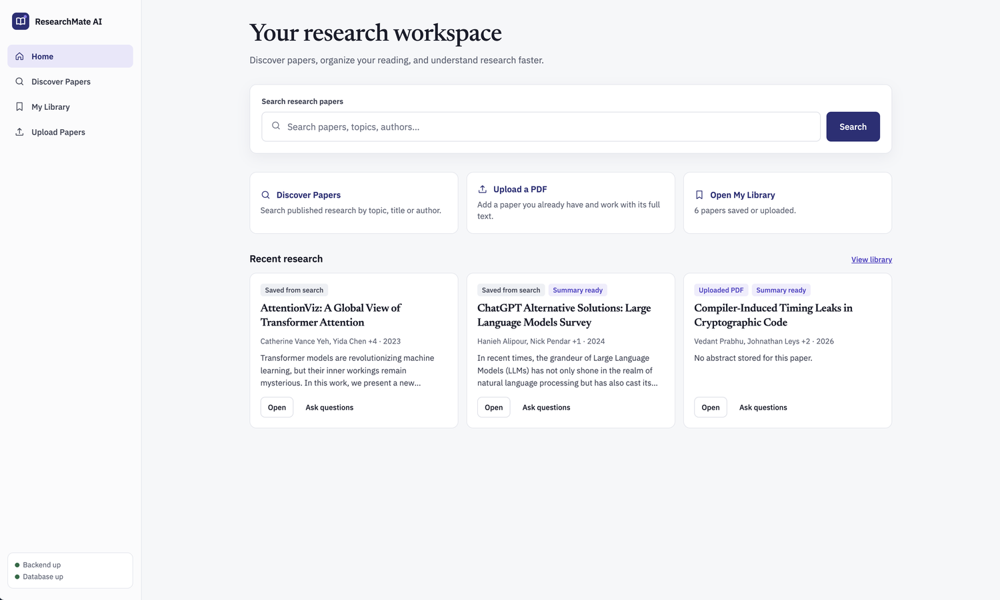
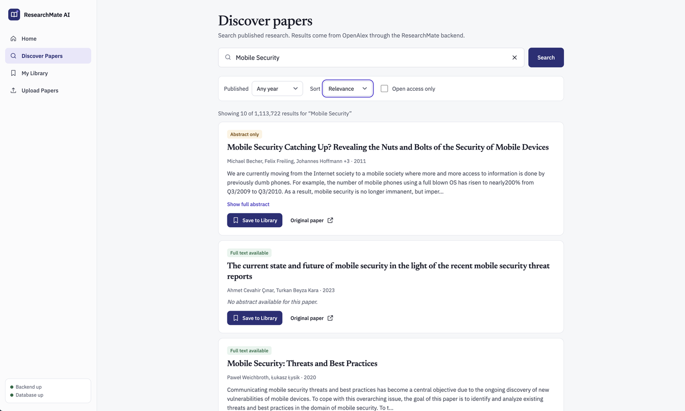
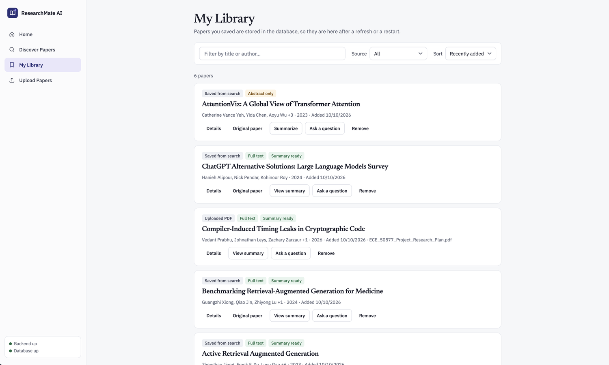
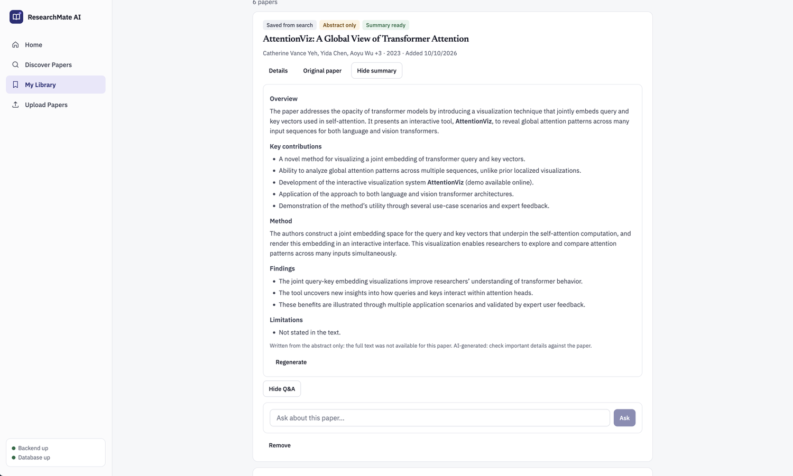
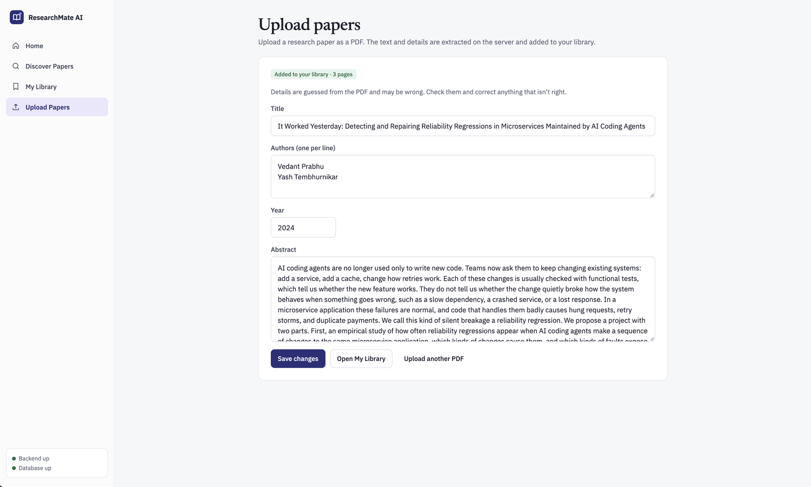

# ResearchMate AI: AI Research Assistant

A small full-stack web app for working with research papers: search real papers, save them to a local library, upload PDFs, get LLM summaries and ask questions about a paper. Built for Homework 1 (coding-agent assisted development).

## Features

| Feature | How it works |
|---|---|
| **Search papers** | Discover page queries the [OpenAlex](https://openalex.org) works API (no key needed). Shows title, authors, year, abstract and a link; filters for year, open access and sort order. |
| **Save to a local library** | "Save to Library" stores the paper in PostgreSQL. My Library lists, searches, sorts and removes papers and survives page refreshes and backend restarts. |
| **Upload PDFs** | Upload page sends a PDF to the backend. Apache PDFBox extracts the full text and the title, authors, year and abstract are guessed from the first page. A review form lets you correct anything the heuristics got wrong. Scanned (image-only) PDFs are rejected: there is no OCR. |
| **Summaries** | "Summarize" sends the paper's real text to an LLM (Purdue GenAI Studio, `gpt-oss:120b`). Uses the full PDF text when available (uploads, or the open-access PDF of a saved paper), otherwise the abstract, and says which. Summaries are cached. |
| **Ask questions** | "Ask a question" retrieves the most relevant excerpts of the selected paper (keyword scoring) and asks the LLM to answer only from them, with `[n]` citations and a "Passages used" section. If the text does not contain the answer it says so. |

## Screenshots

**Home**: search box, quick actions and your most recent papers.



**Discover**: search results from OpenAlex with year, sort and open-access filters. "Full text available" and "Abstract only" badges show what the summary and Q&A can use.



**My Library**: saved and uploaded papers stored in PostgreSQL, with summary and Q&A actions on each one.



**Summary and Q&A**: an LLM summary of one saved paper. This one was written from the abstract only, and the app says so. The "Ask about this paper" box sits underneath.



**Upload a PDF**: title, authors, year and abstract are extracted from the PDF and shown in a form so you can correct them.



## Architecture

```
React + TypeScript (Vite, :5173)  --/api proxy-->  Spring Boot 4 (Java 21, :8080)  -->  PostgreSQL
                                                         |-- OpenAlex API (paper search)
                                                         |-- Purdue GenAI Studio API (LLM, key stays on the server)
                                                         |-- Apache PDFBox (PDF text + metadata)
```

- `frontend/`: React 19, React Router, plain CSS. Pages: Discover, My Library, Upload Papers.
- `backend/`: Spring Boot (Web MVC, Spring Data JPA). Packages under `com.researchassistant`: `controller`, `service`, `repository`, `entity`, `dto`, `exception`.
- One `papers` table (saved and uploaded papers share it). Hibernate creates and updates it (`ddl-auto=update`).
- Errors are returned as `{ "error": { "code", "message", "retryable" } }` and shown in the UI.
- More detail: [docs/architecture.md](docs/architecture.md).

### API

| Method | Path | Purpose |
|---|---|---|
| GET | `/api/health` | backend + database status |
| GET | `/api/papers/search?q=&yearFrom=&sort=&openAccessOnly=&page=&limit=` | search OpenAlex |
| POST / GET | `/api/library` | save a paper / list (`q`, `source`, `sort`) |
| PATCH / DELETE | `/api/library/{id}` | edit metadata / remove |
| POST | `/api/uploads` | upload a PDF (multipart field `file`, max 25 MB) |
| GET / POST | `/api/library/{id}/summary` | cached summary / generate (`?refresh=true` to redo) |
| POST | `/api/library/{id}/ask` | `{ "question": "..." }` returns answer, basis and cited passages |

## Prerequisites

- Java 21 and Maven (or use the included `./mvnw`)
- Node.js 22+ and npm
- PostgreSQL 15+ running locally
- A Purdue GenAI Studio API key (Settings > Account > API Keys at <https://genai.rcac.purdue.edu>), or any OpenAI-compatible chat endpoint

## Setup and run

1. **Create the database** (macOS/Homebrew example):
   ```bash
   brew install postgresql@17 && brew services start postgresql@17   # skip if already installed
   createdb research_assistant
   ```
   By default the backend connects to `jdbc:postgresql://localhost:5432/research_assistant` as your OS user with no password. Override with `DB_URL`, `DB_USERNAME`, `DB_PASSWORD` in `.env` if yours differs.

2. **Configure secrets.** Copy the template and fill it in. `.env` is git-ignored and must never be committed:
   ```bash
   cp .env.example .env
   ```
   ```
   LLM_BASE_URL=https://genai.rcac.purdue.edu/api
   LLM_API_KEY=<your key>
   LLM_MODEL=gpt-oss:120b
   OPENALEX_API_KEY=            # optional, raises the free daily search budget
   ```
   The backend reads `../.env` at startup, so restart it after any change. Search, library and upload work without the LLM settings; only summaries and questions need them.

3. **Start the backend** (terminal 1):
   ```bash
   cd backend
   mvn spring-boot:run        # or ./mvnw spring-boot:run
   ```
   Check <http://localhost:8080/api/health>: it should report `"status":"UP","database":"UP"`.

4. **Start the frontend** (terminal 2):
   ```bash
   cd frontend
   npm install
   npm run dev
   ```
   Open <http://localhost:5173>. The sidebar shows Backend/Database status.

## Using the app

1. **Discover Papers**: search a topic, expand abstracts, press **Save to Library**.
2. **Upload Papers**: pick a PDF, check the extracted title/authors/year/abstract, fix anything wrong, **Save changes**.
3. **My Library**: press **Summarize** or **Ask a question** on any paper. The badge shows whether the paper has full text or only an abstract.

## Known limitations

- PDF metadata is heuristic (largest font = title, name-like lines = authors). Unusual layouts can be wrong; the review form exists for that. No OCR for scanned PDFs.
- Papers saved from search have full text only if OpenAlex lists a downloadable open-access PDF; otherwise summaries and answers use the abstract and say so.
- Very long papers are cut to about 60,000 characters for summaries; Q&A uses the best-matching excerpts, found by keyword matching (no embeddings), so a question phrased very differently from the text can miss the right passage.
- The LLM service allows 20 requests per minute per user; the app shows a retry message when it is hit. It may also need the Purdue network or VPN off campus.
- LLM output can be wrong. The UI labels it AI-generated; check important details against the paper.
- No authentication (single local user) and no automated tests (planned for HW2).

## Project documents

`docs/` holds the project plan, requirements checklist, architecture notes, checkpoint log, testing log, and the coding-agent reflection log used for the report.
